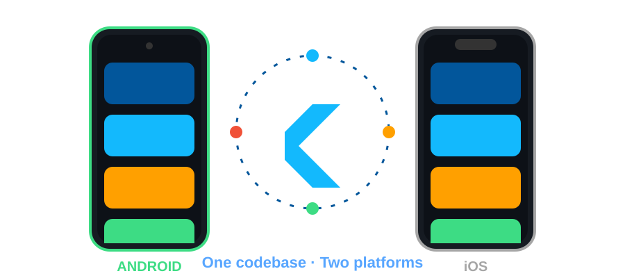

<!-- Put this file in a repo named exactly like your GitHub username (YOUR_USERNAME/YOUR_USERNAME). Keep the /assets folder next to it. -->


<div align="center">

<a href="https://git.io/typing-svg"></a>

<br/>


<br/><br/>



</div>

---

## 👋 About Me

Flutter Developer with **3 years** of experience building, testing and releasing **8+ production cross-platform apps** for **Android & iOS** in fintech, digital lending, logistics and HR-tech.

- 📱 Contributed to **two live fintech apps** with a combined **10L+ (1 million+) Google Play downloads**
- 🔐 Strong in secure auth, KYC, biometrics, payment gateways and real-time features
- 🧠 Solved **300+ DSA problems** on LeetCode & GeeksforGeeks
- 📍 Based in New Delhi, India

---

<div align="center">

# ⚡ TECH STACK


<br/>

## 📱 Mobile & Devices


<br/>


## 🔥 Backend, Cloud & Tools


## 🧩 Architecture & State Management


</div>

<details>
<summary><b>📋 Full skill list (click to expand)</b></summary>

| Area | Skills |
|---|---|
| **Mobile** | Flutter, Dart, Java, Swift, Jetpack Compose, Android, iOS, Responsive UI, Custom Widgets, Animations, Platform Channels, Deep Linking |
| **Backend & APIs** | REST, Dio, HTTP, JSON, WebSocket, JWT, OAuth, Firebase Auth, Firestore, FCM, Crashlytics, Analytics, Remote Config |
| **Security & Payments** | Secure Storage, Biometrics, OTP, KYC, Document Verification, Razorpay |
| **Local Storage** | Hive, SQLite, SharedPreferences |
| **Testing** | Unit, Widget & Integration Tests, Flutter DevTools, Postman |
| **DevOps & Release** | Git, GitHub Actions, CI/CD, Firebase App Distribution, Play Console, App Store Connect, TestFlight |
| **Integrations** | Google Maps SDK, Google Sign-In, OCR APIs, Push Notifications, i18n |

</details>

---

## 🚀 Featured Projects

<table>
<tr>
<td width="50%" valign="top">

### 💸 SalaryOnTime
**Fintech / Digital Lending** · 10L+ downloads
Registration, loan application, eligibility, offers and repayment flows.
`Flutter` `Dart` `REST` `Firebase`

[](#)
[](#)

</td>
<td width="50%" valign="top">

### 🚨 EmergencyPaisa
**Digital Lending / Fintech** · 10L+ downloads
Biometric login, KYC, document verification, Razorpay repayments.
`Flutter` `Firebase` `Razorpay` `Secure Storage`

[](#)

</td>
</tr>
<tr>
<td valign="top">

### 🛵 Gig Partner App
OTP login, OCR document verification, referrals, live location tracking, Razorpay, FCM.
`Flutter` `Google Maps` `OCR` `FCM`

</td>
<td valign="top">

### 🚚 Unified TMS
B2B/B2C logistics platform with real-time shipment tracking and role-based access.
`Flutter` `GetX` `REST` `Firebase`

</td>
</tr>
<tr>
<td colspan="2" valign="top">

### 🧑‍💼 Isoping HRMS
Multilingual attendance, payroll and leave modules with REST API and payment integration.
`Flutter` `Firebase` `Razorpay` `i18n`

</td>
</tr>
</table>

> 🔗 Replace each `(#)` above with your real Play Store / App Store links.

---

## 💼 Experience

```text
2026 ─ Present   Flutter Developer · LNVS Fintech Pvt. Ltd.
                 Fintech & digital lending apps · OTP, biometrics, KYC, payments

2025 ─ 2026      Flutter Developer · Isourse Technologies Pvt. Ltd.
                 Gig Partner, Unified TMS, Isoping HRMS · CI/CD with GitHub Actions

2023 ─ 2025      Flutter Developer · Amron Software Technologies Pvt. Ltd.
                 Apps from scratch to Play Store / App Store · live location tracking
```

🎓 **B.Tech, Computer Science & Engineering** — Bansal Institute of Engineering & Technology, Lucknow (2019–2023)

---

<div align="center">

## 📊 GitHub Stats


## 📫 Let's Connect

<a href="https://linkedin.com/in/YOUR_LINKEDIN"></a>
<a href="mailto:akshayjaiswal1618@gmail.com"></a>
<a href="https://YOUR_PORTFOLIO"></a>


</div>


